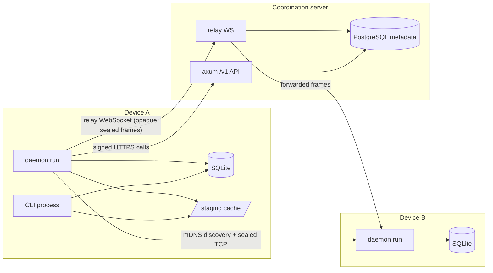

# SyncEngine — Architecture

**Audience:** someone learning Rust and systems design from this codebase. This document explains
the components, their responsibilities, and how they fit together. For the end-to-end walkthrough of
a single file change see `docs/DATA_FLOW.md`; for the wire details see `docs/PROTOCOL.md`.

**Background documents:** `AGENT.md` (engineering brief), `docs/SRD.md` §3 (high-level architecture,
serves as the HLD), `docs/syncengine_lld/` (client/server module diagrams).

## 1. What SyncEngine is

A CLI-first file synchronizer for your own paired devices:

- Every device owns a cryptographic identity (no accounts, no passwords).
- Devices are paired explicitly (one device shows a code, the other approves).
- Every enabled shared folder syncs with every trusted peer — directly over the **LAN** when
  possible (mDNS + TCP), or through the coordination server's **relay** (opaque WebSocket frames)
  when the peers cannot reach each other.
- Conflicts never destroy data: both revisions are kept and surfaced as conflict copies.
- The server stores **metadata only**: device identities, pairing state, folder memberships, and
  short-lived relay-session bookkeeping. File contents are end-to-end encrypted and never stored.

## 2. Workspace layout

```
Cargo.toml                     # workspace: one Cargo.lock, shared dependency versions
client/                        # package `syncengine`, binary `syncengine`
server/                        # package `syncengine-server`, binary `syncengine-server`
crates/
  syncengine-protocol/         # shared wire types, IDs, version vectors, path rules, auth strings
  syncengine-storage/          # `Store` trait + `SqliteStore` (client database)
  syncengine-engine/           # scanning, staging, chunking, crypto identity, sync orchestration
  syncengine-transport/        # mDNS discovery, LAN TCP, relay WebSocket, handshake, sessions
docker-compose.yml             # local PostgreSQL for the server
Makefile                       # fmt / fmt-check / lint / test / check shortcuts
```

Dependency direction (each layer only knows the ones to its left):

```
syncengine-protocol  →  syncengine-storage  →  syncengine-engine  →  syncengine-transport  →  syncengine
        ↘ syncengine-server (protocol only + Postgres/axum)
```

`syncengine-protocol` deliberately has no filesystem, database, or network dependencies, so it is
trivially testable and safe to share between the client and the server.

## 3. Components and responsibilities

### 3.1 `syncengine-protocol` — the shared vocabulary

| Module | Responsibility |
|---|---|
| `ids` | Newtype IDs (`DeviceId`, `FolderId`, `EntryId`, `ChangeId`) over UUIDv4. |
| `version` | `VersionVector` (BTreeMap<DeviceId, u64>) and `CausalOrder` (Dominates / DominatedBy / Equal / Concurrent). |
| `path` | `RelativePath`: forward-slash validation (`../`, absolute paths, empty segments rejected). |
| `messages` | `PeerMessage` enum (the wire protocol), `PROTOCOL_VERSION`, `MAX_FRAME_BYTES`, the hello transcript. |
| `control` | Canonical control-plane request signing, pairing-code proof, SHA-256 helpers, header names. |
| `lib.rs` | `ChangeRecord`, `Operation`, `ContentHash` (BLAKE3 hex), version-compatibility check. |

### 3.2 `syncengine-storage` — the client database

- `Store` (in `traits.rs`) is a trait describing everything the engine needs from persistence:
  peers, folders, folder memberships, file entries, the change journal, per-peer delivery targets,
  tombstones, conflicts, applied-remote-change records, transfers, content objects.
- `SqliteStore` (in `sqlite.rs`) implements it over a single SQLite connection with WAL mode,
  foreign keys on, and embedded forward-only migrations (`schema_migrations` table).
- The trait boundary is what keeps the engine testable: `SyncEngine<S: Store>` works against any
  implementation, and most engine tests use `SqliteStore::open_in_memory()`.

### 3.3 `syncengine-engine` — the sync brain

| Module | Responsibility |
|---|---|
| `crypto` | `Identity`: Ed25519 signing keypair + X25519 static keypair; `seal`/`open` (ECDH → HKDF-SHA256 → ChaCha20-Poly1305); identity file persistence with `0600` on Unix. |
| `scanner` | Conservative recursive scan of a folder root: rejects symlinks, marks the scan incomplete on any read error, produces sorted file lists. |
| `integrity` | BLAKE3 hashing of files and buffers; `verify_file` for staged objects. |
| `staging` | Content-addressed immutable cache (`staging/<blake3-hex>`): `stage_file`, `receive` (durable `.recv-<hash>` receive files with resume offsets), verification. |
| `chunker` | Fixed-size (256 KiB default) offset-addressed chunk reads. |
| `sync` | `SyncEngine<S: Store>`: `queue_local_changes` (scan → journal), `plan_remote_change` (causal decision), `commit_remote_file` / `commit_remote_delete` / `commit_conflict_delete`, conflict preservation and resolution, tombstone retirement, staging GC. |

Key idea: the engine never talks to the network. It turns disk state into `ChangeRecord`s and back,
which is why the same engine drives LAN, relay, and tests with plain in-memory stores.

### 3.4 `syncengine-transport` — talking to a peer

| Module | Responsibility |
|---|---|
| `codec` | 4-byte big-endian length prefix + payload framing, 16 MiB cap rejected before allocation. |
| `channel` | `FrameIo` trait (`FramedIo` for TCP, `WsIo` for WebSockets) and `PeerChannel`: plaintext JSON during the handshake, sealed frames after. |
| `handshake` | `Hello`/`HelloAccepted` exchange, transcript verification, `verify_peer` against the stored trusted `Peer` (keys must match exactly; discovery never grants trust). |
| `discovery` | mDNS advertisement (`_syncengine._tcp.local.`) and per-device lookup returning best-first candidate addresses. |
| `lan` | TCP listener and connector used by the delivery pass. |
| `relay` | WebSocket connection to the server's relay path, authenticated with control-plane signatures in query parameters. |
| `session` | `run_session`: the symmetric changes/chunks/acks loop over one established channel; tombstones are retired at the end. |

### 3.5 `syncengine` (client crate) — the `syncengine` binary

| Module | Responsibility |
|---|---|
| `cli` | clap definitions for every command and flag. |
| `config` | `config.toml` loading/validation (unknown keys rejected), platform default paths, bounds checks. |
| `state` | Lazy local state: data dir, identity, SQLite store, device id; builds `SyncEngine` on demand. |
| `commands` | One function per CLI command (`init`, `status`, `share`, `devices`, `pair`, `sync`, `daemon`, `conflicts`, `logs`, `doctor`, …). |
| `remote` | `RemoteClient`: signed HTTP calls to the coordination server (register, pair, memberships, relay sessions). |
| `delivery` | One sync pass: bind LAN listener → mDNS advertise → for each trusted peer try LAN then relay → serve inbound windows → `gc_staging`. |
| `daemon` | `daemon start/status/stop` via a state file (`daemon.json`: pid, heartbeat, interval) plus signals; the foreground loop scans and runs a pass every interval. |

### 3.6 `syncengine-server` — coordination + relay

| Module | Responsibility |
|---|---|
| `main.rs` | `serve --bind --database-url` and `migrate`; TLS is explicitly out of scope (terminate in a reverse proxy). |
| `api` | The `/v1` HTTP surface: device registration, device list/revoke/keys, pairing requests, memberships, relay sessions, relay WebSocket upgrade; 64 KiB body cap. |
| `auth` | Ed25519 verification of the canonical request string, timestamp skew (300 s), revocation checks. |
| `db` | `deadpool-postgres` pool + embedded SQL migrations (`server/migrations/`). |
| `relay` | Pairs the two WebSocket participants of a session and forwards opaque frames with bounded (32-message) buffering; never persists payloads. |
| `models`, `state`, `error` | Row mapping, app state (pool + relay registry), the `{"error":{"code","message","request_id"}}` envelope. |

## 4. Runtime topology



Key properties:

- **The server is optional for LAN sync.** Two paired devices that can reach each other over the
  LAN sync without the server being configured or reachable.
- **The relay carries only sealed frames.** The server forwards bytes between two authenticated
  participants; it cannot read them (see `docs/PROTOCOL.md`).
- **One writer per device.** Every client command and the daemon open the same SQLite database;
  they are not designed to run concurrent *write* operations against it beyond SQLite's own locking
  (the daemon is the one long-running writer; short-lived CLI commands interleave).

## 5. Core data structures

- `Identity` — the device's two keypairs. Not `Clone` on purpose: one owner, passed by reference.
- `SyncEngine<S: Store>` — device id + store + `StagingStore`; the only place sync decisions are made.
- `ChangeRecord` — one journal entry: operation, paths, content hash, size, version vectors,
  origin device, timestamp. This is what peers exchange.
- `FileEntry` — the current per-path state (`present`/`deleted`), its hash, and its version.
- `Tombstone` — a durable record of a deletion (path, version, deleting change) used to decide
  races against local deletions.
- `PeerChannel<'a>` — borrows the `Identity` and owns a boxed `FrameIo`; sealing flips on after
  the handshake.
- `DaemonState` — pid + heartbeat written by the agent and consulted (with a liveness check) by
  `daemon status` and `doctor`.

## 6. Design invariants

1. **Journal before advertise.** `queue_local_changes` stages the exact bytes it hashed, so a file
   edited while a transfer is pending still delivers the staged revision.
2. **Idempotent application.** `applied_remote_changes` makes re-delivery after a crash a no-op
   (`plan_remote_change` answers `AlreadyApplied`/`Stale` instead of rewriting).
3. **Causality, not clocks.** Version vectors decide ordering; timestamps are informational.
4. **Deletes are conservative.** An incomplete scan never produces deletions; renames are journaled
   as delete + create (SRD §10).
5. **Conflicts keep both revisions.** Nothing is overwritten silently; the loser is preserved as a
   sibling copy and recorded in `conflicts`.
6. **Trust is explicit.** Pairing is a two-sided approval with an out-of-band code; mDNS discovery
   and handshakes alone grant nothing.
7. **The server stays dumb.** It authorizes sessions and forwards bytes; it stores no file contents
   and no device-local absolute paths.

## 7. Where to look for what

| Question | Start at |
|---|---|
| How does a change travel end to end? | `docs/DATA_FLOW.md` |
| What exactly goes over the wire? | `docs/PROTOCOL.md` |
| What does each table mean? | `docs/DATABASE.md` |
| Why was X built this way? | `docs/DECISIONS.md` |
| What works / what does not? | `docs/STATUS.md` |
| Learning order and exercises | `docs/LEARNING_GUIDE.md` |
| Scanning and journaling | `crates/syncengine-engine/src/sync.rs` (local section) |
| Conflict decisions | `sync.rs::plan_remote_change` |
| Session loop | `crates/syncengine-transport/src/session.rs` |
| Delivery pass | `client/src/delivery.rs` |
| Server routes | `server/src/api.rs` |
| Relay forwarding | `server/src/relay.rs` |
