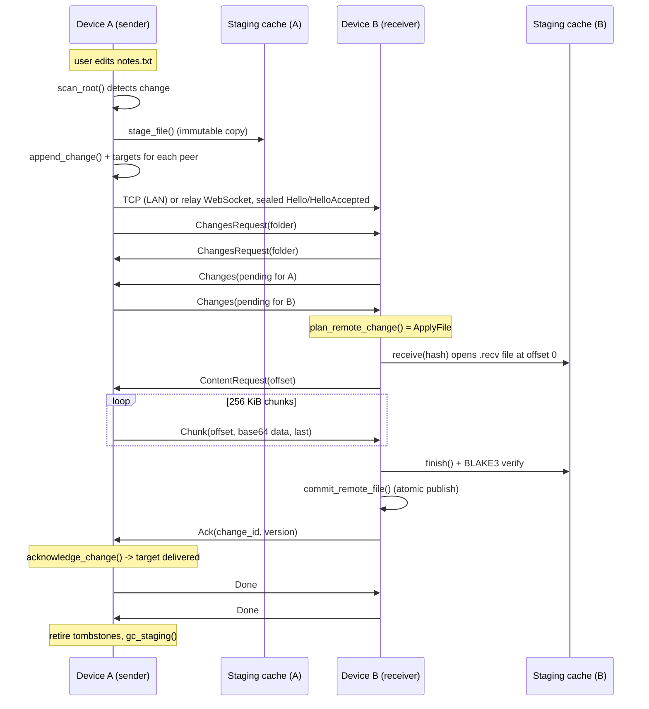

# SyncEngine — Data Flow

**Audience:** someone learning how a change actually moves through the system. This is the "follow
one file" walkthrough. Read `docs/ARCHITECTURE.md` first for the component map; `docs/PROTOCOL.md`
has the exact wire details; `docs/DATABASE.md` explains the tables referenced here.

## 1. The 60-second version

1. You edit `notes.txt`. A scan notices the new hash and **journals** a change (a row in `changes`)
   for every trusted peer of that folder, after **staging** the exact bytes into the content cache.
2. A sync pass opens a **session** with a peer — LAN TCP if reachable, relay WebSocket otherwise.
3. The two sides exchange the list of changes the other has not acknowledged yet.
4. For each change worth applying, the receiver pulls **content chunks**, verifies the BLAKE3 hash,
   and **publishes** the file atomically.
5. The receiver sends an **ack**; the sender records it. Once all peers acknowledge a deletion,
   its tombstone is **retired**. Unused staged content is **garbage-collected**.

## 2. Sequence of a file update

## 3. Phase details

### Phase 0 — local edit → journal (`sync.rs::queue_local_changes`)

- `scan_root` walks the folder, rejecting symlinks and any path the scan cannot read. On any error
  the scan result is marked **incomplete**.
- For each file the scanner emits `New` / `Changed` / `Unchanged` / `Deleted` by comparing
  (path → size + mtime) against `file_entries`, re-hashing with BLAKE3 when size/mtime moved.
- `New`/`Changed`: the exact bytes are copied into the content-addressed staging cache
  (`staging/<blake3-hex>`). A content object row tracks a refcount per path copy.
- `Deleted`: only journaled when the scan was complete (`deletions_skipped` counts otherwise).
  Deletes always carry **no content hash**.
- Every emitted `Operation` becomes one `ChangeRecord` with a new version: the device's counter in
  the record's version vector is bumped, carrying the previous path version as the parent.
- `append_change(record, peers)` inserts the change plus one `change_targets` row per trusted peer
  of the folder — this is the per-peer delivery ledger. Renames are journaled as **delete + create**
  (the scanner never emits `Rename`); the tombstone ties the two paths together.
- If the folder hash was unchanged, nothing is journaled (`unchanged` in the report).

### Phase 1 — session establishment (`client/src/delivery.rs`, `transport/`)

- The pass binds a temporary LAN listener and advertises `_syncengine._tcp.local.` with the device
  id in the TXT record.
- For each trusted peer, LAN is tried first: mDNS lookup (best address first) then a TCP dial with
  a timeout. If that fails and a `server_url` is configured, fall back to the relay.
- **Relay rule:** only the initiator dials the relay. The initiator is the device whose id sorts
  lexicographically smaller; the other side receives the connection through its inbound window.
- The handshake is always the same: plaintext `Hello` (device id, public keys, timestamps,
  signature over the hello transcript) → `HelloAccepted`. `verify_peer` requires the presented keys
  to exactly match the stored trusted `Peer`; mDNS discovery alone grants no trust.
- From that point on, every frame is sealed: X25519 ECDH → HKDF-SHA256 → ChaCha20-Poly1305.

### Phase 2 — change exchange (`transport/src/session.rs`)

- For each folder both devices share, each side sends `ChangesRequest { folder_id }`.
- On receiving a request, the peer answers with `pending_for_peer(device_id)` filtered to that
  folder — i.e. changes whose `change_targets` row for this peer is not yet acknowledged. The
  sender tracks them as `outstanding_acks`.
- The receiver handles each incoming change via `plan_remote_change`, which consults the local
  entry, the version vectors, and (when needed) the tombstone:

| Plan | When | Action |
|---|---|---|
| `AlreadyApplied` | change id already in `applied_remote_changes` | ack immediately |
| `Stale` | local state already at/after this version (incl. delete-vs-edit) | ack immediately |
| `Delete` | delete that dominates the local entry | `commit_remote_delete` (entry → deleted, tombstone inserted) then ack |
| `ConflictDelete` | incoming delete concurrent with a local edit | `commit_conflict_delete` (preserve copy, record conflict, apply delete) then ack |
| `ApplyFile` | new/causally newer file | pull content (below), then commit |
| `Conflict` | concurrent edit vs edit | pull content, preserve local as sibling copy, apply remote, record conflict |

- Deletions are therefore applied during metadata exchange (no content needed).

### Phase 3 — content transfer

- Receiver: `staging.receive(expected_hash, size)` opens (or reuses) a durable partial file
  `.recv-<hash>` in the staging directory and returns the current offset — **this is the crash
  resume mechanism**. The offset goes out in `ContentRequest`.
- Sender (`serve_content`): validates that the change exists, matches the requested folder/entry,
  matches the expected size, that staging still holds verified content, and that the offset is
  within bounds; then seeks to the offset and streams `Chunk` messages (absolute offset, base64
  payload, `last` flag) of `chunk_size` (default 256 KiB).
- Receiver: each `Chunk` must continue exactly where the file left off (`write_chunk` enforces
  offset continuity). On `last`, `finish()` verifies the BLAKE3 hash. A torn/leftover tail from a
  previous crash causes a hash mismatch, and the partial is discarded and restarted cleanly.
- Chunks are sealed frames on the wire, so the base64 only protects the JSON envelope.

### Phase 4 — commit (`sync.rs::commit_remote_file`)

In order:

1. Re-check `is_applied` (idempotency): if present → `AlreadyApplied` and the caller acks.
2. Publish the staged object at the relative path **atomically** (temp file + rename).
3. If the entry was a rename (record has a previous path), the old path is removed.
4. A superseded local entry at this path is marked `deleted`, its content refcount decremented.
5. Upsert the `file_entries` row with the incoming version; `note_content` bumps the new object's
   refcount; `mark_change_applied` records the change id.

The receiver then sends `Ack { change_id, version }` (the version is echoed from the *applied*
local entry).

### Phase 5 — acknowledgement and retirement

- Sender: `acknowledge_change(change_id, peer)` marks that peer's target delivered/acknowledged.
- At the end of the session, `retire_acknowledged_tombstones` deletes tombstone rows whose change
  is delivered and acknowledged for **every trusted peer that shares the folder** (unpaired peers
  stop counting).
- At the end of the whole pass, `gc_staging` removes staged objects with refcount ≤ 0 that are not
  referenced by pending deliveries (`pending_content_hashes`).

### Phase 6 — session end

- Each side sends `Done` when it has no outstanding requests, acks, or fetches, and stops when both
  sides are done with nothing in flight. Silence beyond `max_idle` is a timeout error.
- The pass reports per-peer `SessionReport { folders, applied, delivered, conflicts, errors }`.

## 4. Conflict flows on disk

| Scenario | Canonical path | Preserved copy | Conflict row |
|---|---|---|---|
| Edit vs edit | remote revision | local revision copied to `"{path} (conflict from {local-id})"` | yes (`unresolved`) |
| Delete vs edit (delete is stale) | untouched locally | — | no (delete is acked as stale; the edit flows back later) |
| Edit vs delete (delete concurrent) | deleted | local revision copied as sibling | yes |
| Recreate after delete | new file, if its version dominates the tombstone | otherwise treated as a conflict copy | maybe |

Important properties:

- **Conflict copies are ordinary synced files.** Once written they are scanned, journaled, and
  delivered like any other file — that is how a "loser" revision reaches every device.
- **Copies are deduplicated:** a second conflict for the same path appends `-2`, `-3`, … The remote
  side's copy is labeled with the origin device id; a locally preserved revision is labeled with
  the local device id.
- **File conflicts are not marked applied until the copy exists.** If the process dies mid-way, the
  conflict stays `Conflict` in `conflicts`, and the next session retries the whole step.

## 5. Crash points (what survives)

| Crash point | Repair path |
|---|---|
| After journaling, before delivery | Change + targets are durable; the next session's `ChangesRequest` re-sends it. |
| Mid content transfer | `.recv-<hash>` partial keeps the received prefix; next session resumes at that offset. |
| Torn tail in the partial | Hash mismatch at `finish()` → partial discarded, transfer restarts cleanly. |
| After publication, before `applied` record | Re-delivery re-plans as `Stale` (local entry already at that version) → acked. |
| After apply, before ack | Same: `AlreadyApplied`/`Stale` → acked again. |
| Mid conflict preservation | Conflict remains recorded; step retried next session. |
| After tombstone retirement | Peers acked the delete; nothing left to do. |

All store mutations are single SQLite transactions, so the journal either has a full change or none
of it.

## 6. What the user observes

- `syncengine sync` prints per-folder journal counts, then one line per peer session
  (`via lan` / not connected), the delivered/applied/conflict counters, and any warnings.
  An unreachable peer is reported as "not connected" but does not make the command fail —
  its changes stay journaled for the next pass.
- The daemon repeats the same pass every scan interval; `syncengine logs` tails its log file.
- `syncengine conflicts` lists unresolved rows; `syncengine status` shows queue sizes per peer.
